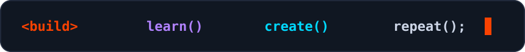
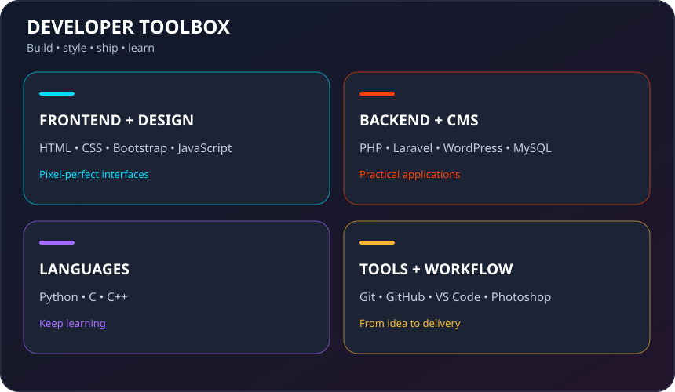
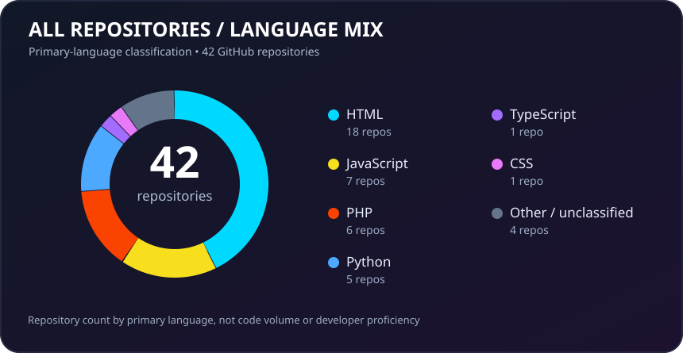

### Hey, I'm Tahashibur 👋

**Web Developer from Bangladesh 🇧🇩**  
I build responsive websites, thoughtful interfaces, and practical web applications.

 

---

## 01 / A little about me

I'm **Tahashibur Rahman**, a web developer who likes the intersection of **clean design and working code**. I enjoy frontend details, backend logic, and turning complex ideas into experiences that feel simple to use.

- 🔭 **Building:** Track Back
- ⚙️ **Working with:** PHP, Laravel, Bootstrap, JavaScript, HTML, CSS, MySQL and WordPress
- 🌱 **Learning:** Python and deeper backend concepts
- 🎨 **Interested in:** UI/UX, responsive design, web performance and e-commerce
- 💬 **Ask me about:** HTML, CSS, Bootstrap and JavaScript
- 📬 **Reach me:** [tahashiburrahman5@gmail.com](mailto:tahashiburrahman5@gmail.com)
- ⚡ **Beyond code:** Sarcasm, hanging out and good conversations

---

---

## 02 / My developer toolbox

A full-width view of the technologies I work with and explore, from responsive interfaces to Laravel and WordPress projects.

Python is an area I'm actively learning. 

---

## 03 / The kind of work I enjoy

🌐 **Frontend development** — responsive layouts, CSS details, Bootstrap and approachable interfaces.

⚙️ **Laravel & PHP applications** — workflows, forms, databases and practical backend features.

🛒 **E-commerce experiences** — product layouts, category pages and storefront experiences.

🧩 **Extensions & experiments** — exploring JavaScript outside traditional websites.

🐍 **Still learning** — Python and new approaches to problem solving.

> Build something. Break something. Learn something. Repeat.

---

## 04 / Repository landscape & selected work

Based on GitHub's primary-language repository search at the time of this update. It includes the profile repository; four repositories did not match the language categories and are labeled unclassified. This is not a line-of-code breakdown.

### 🛒 [Laravel E-commerce](https://github.com/TahashiburRahman/Basic-Ecommerce-Laravel-12)
An e-commerce application built with Laravel.

### 💼 [Job Finder BD](https://github.com/TahashiburRahman/job-portal)
A Laravel 12 job portal with public job search, employer and candidate workspaces, and administration features.

### 🏢 [Office Management System](https://github.com/TahashiburRahman/OMS-Laravel)
An office management application using Laravel.

### 🌐 [WordPress Dynamic Website](https://github.com/TahashiburRahman/WordPress-FullStack-Dynamic-Website-Sixthandrio)
A WordPress website project.

### 🧩 [Daily Work Log Extension](https://github.com/TahashiburRahman/task-update-extension)
An offline-first browser extension that saves work entries locally.

---

## 05 / GitHub activity

**Want to see what I'm working on?**

My contribution calendar and repository activity are maintained directly by GitHub. These links stay useful even if third-party stats services are unavailable.

---

## 06 / Around the web

 

---

### Let's build something worth sharing 🚀

I enjoy talking about code, creative ideas and interesting projects.  
**[Email me](mailto:tahashiburrahman5@gmail.com)** · **[Connect on LinkedIn](https://www.linkedin.com/in/tahashib7/)**

*Stay curious. Keep building.*

**— [Tahashibur Rahman](https://github.com/TahashiburRahman)**

